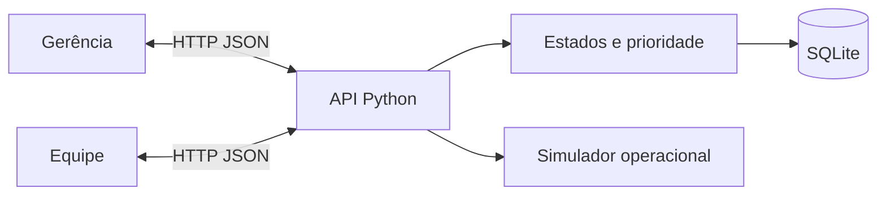

# Bovinu's Flow — BoviFlow 2.0

**Hackathon FMU Tech 2026.2 × Bovinu's Grill & Beer — Augusta**

Inteligência operacional para o serviço de almoço da Bovinu'S Grill & Beer (Augusta). Projeto independente do Hackathon FMU 2026. Baseado nos slides 7–9 e 13 de `Hackaton BovinuS.pptx`: cerca de 20 mesas no salão inferior, 30 no principal e 40 no superior; cliente se serve, pesa o prato e escolhe a mesa. Não altera pagamento, cozinha, estoque nem modelo de atendimento. Numeração, lugares, históricos e estados iniciais são hipóteses.

## Entrega oficial — material para a banca

| Material | Acesso |
|---|---|
| **Vídeo demonstrativo (1min14s)** | [Assistir/baixar MP4](entrega/video-demonstracao.mp4) |
| **Apresentação (5 slides)** | [Baixar PowerPoint](entrega/Apresentacao-Bovinus-Flow.pptx) |
| **Pitch da final (até 4 minutos)** | [Roteiro](docs/PITCH.md) |
| **Código e banco** | [Servidor/API](app.py), [regras e SQLite](core.py), [simulador](simulator.py), [interface](static/), [testes](tests/) |

Os links são relativos ao repositório e funcionam após o envio integral da pasta `entrega/`. No GitHub, abra o arquivo MP4 e, se não houver player, selecione Download raw file. O vídeo é uma montagem narrada de capturas da demonstração executada em Chromium por ponte HTTP com a API local real; a narração é sintetizada. Não é gravação de uma implantação real.

## Problema e solução

**Problema:** a Bovinu'S deseja medir por quanto tempo as mesas permanecem sujas após a saída do cliente. A operação distribui cerca de 90 mesas em três salões e os garçons também atendem bebidas. Sem medição do ciclo, fica difícil identificar gargalos ou testar prioridades de limpeza.

**Solução:** BoviFlow acompanha a ocupação e os estados da mesa, mede tempos, ordena tarefas de limpeza, atualiza os indicadores pela API e permite simular estratégias e cenários financeiros. A saída definitiva e a higienização exigem confirmação humana. O cliente não precisa de aplicativo e o serviço por peso permanece inalterado.

## Desenvolvimento e integração

1. Levantamento da dor e do mapa oficial da unidade Augusta.
2. Modelagem da máquina de estados, tabelas SQLite e API HTTP Python.
3. Construção do mapa interativo, dashboard e painel responsivo da equipe.
4. Implementação de cronômetros, motor de prioridade, despacho atômico, indicadores e simulação.
5. Testes de regras, integração HTTP, renderização e fluxo em Chromium; preparação da demonstração.

## Capturas da solução (5 imagens)

**1. Dashboard da unidade — 90 mesas demonstrativas e radar de prioridades**

**2. Fila de limpeza no painel mobile**

**3. Mesa I-01 liberada após a confirmação da equipe**

**4. Simulador — comparação de 12 cenários pareados**

**5. Retorno financeiro — hipóteses ajustáveis**

Capturas da versão 2.0, geradas durante a execução da interface Chromium com ponte de teste para o servidor HTTP local. Dados demonstrativos; não são resultados do restaurante. A navegação direta em localhost permanece pendente de validação no computador de apresentação.

## Impacto e inovação

- **Relevância:** mede espera, limpeza e tempo de liberação sem mudar o almoço por peso.
- **Inovação:** prioridade contextual explicável, despacho atômico e comparação de estratégias operacionais. Visão computacional opcional, experimental, sem identificação facial.
- **Evidências:** 27 testes automatizados aprovados; benchmark sintético com seis cenários melhores, um empate e cinco piores. O ganho médio foi de 1,42 pessoas por cenário, com aumento médio de 13,33 minutos-mesa de indisponibilidade. Não há prova de superioridade em campo.
- **Próximo passo:** piloto controlado no salão principal (~30 mesas), com baseline, qualidade de higienização preservada e avaliação de resultados reais.

## Iniciar em Windows (sem instalar bibliotecas)

1. Instale Python 3.10 ou superior caso não esteja instalado; marque a opção de adicionar ao PATH.
2. Extraia o ZIP inteiro. Abra a pasta BoviFlow no VS Code (opcional).
3. Clique duas vezes em `iniciar.bat` ou execute `python app.py` no terminal da pasta. Não feche o terminal.
4. Abra **http://localhost:8000** no navegador. Painel da equipe: **http://localhost:8000/staff**. Se a porta estiver em uso, execute `python app.py --port 8001` e use a porta correspondente.
5. Para parar, Ctrl+C. Para reiniciar os dados demonstrativos, Configurações → Reiniciar dados de demonstração. A base SQLite fica em `data/demo.db`, criada automaticamente.

Linux/macOS: `python3 app.py`. O núcleo usa somente a biblioteca padrão do Python (HTTP + SQLite), sem Flask, Node, CDN ou API externa. O navegador precisa ser moderno. Não abra index.html diretamente; use o servidor.

## Apresentação em dois aparelhos

Opção simples: abra duas abas no mesmo notebook, uma em `/` e outra em `/staff`. Para celular na mesma rede privada, use `iniciar-rede.bat` (código temporário) e o endereço IPv4 do notebook indicado por `ipconfig`, exemplo `http://192.168.1.10:8000/staff`. Não use esse IP de exemplo se for diferente do seu. Permita a conexão apenas na rede privada quando o firewall solicitar. Não publique este servidor na internet, nem em Wi-Fi público. A comunicação local não usa TLS; o código é compartilhado, não é login individual.

## O que funciona no MVP

- API HTTP e banco SQLite persistente; 90 mesas com seis estados, versões de atualização, trilha de eventos e relógios calculados a partir de timestamps.
- Dashboard, mapa por salão com planta original do slide 7, interface responsiva da equipe e sincronização por consulta a cada 1,8 s (latência real depende da rede e navegador).
- Motor de prioridade baseado em regras: espera (40), ocupação (25), demanda (20, opcional), capacidade (10), meta excedida (5). Normalização quando demanda desconhecida. Acima de 2x a meta, mais antigas primeiro. Não é IA treinada.
- Analytics: espera, limpeza, tempo de liberação, percentual na meta, histórico de 24h e CSV completo. Ciclos incompletos não entram nas médias. Após cancelamento/reinício, espera representa tempo até a última tentativa e inclui o intervalo da tentativa anterior.
- Simulação operacional de três horas com parâmetros configuráveis, tamanhos de grupos, paciência, pico de demanda, tempos de atendimento e limpeza, semente reproduzível, comparação FIFO x regra contextual. Não é um gêmeo digital calibrado. Não modela deslocamentos, bebidas, preferências, disponibilidade de funcionários para outros serviços nem comportamento real de escolha de mesa. A alocação simulada usa a menor mesa compatível; isso não é uma mudança sugerida no atendimento real. A regra de simulação usa grupos em espera; o painel real usa índice de demanda opcional; não são algoritmos idênticos. Resultados podem ser negativos.
- Simulador de retorno financeiro com hipóteses editáveis; contribuição incremental não é lucro líquido. Não há promessa de aumento de receita.
- Vision Lab: eventos simulados de presença/ausência/retorno, explicitamente marcados como simulação. Script opcional OpenCV para uma região fixa de câmera; precisa ser validado em campo. Sem reconhecimento facial ou armazenamento de imagens.

## Novidades da versão 2.0

- **Radar operacional:** contagem de ciclos abertos acima da meta, críticos (2× a meta), possíveis saídas, mesas bloqueadas, salões sem disponibilidade e maior indisponibilidade.
- **Despacho inteligente:** botão “Assumir próxima limpeza” escolhe e muda o estado da mesa prioritária na mesma transação SQLite, respeitando o filtro por salão. Não é atribuição nominal nem controle de identidade dos funcionários.
- **Apresentação guiada:** no dashboard, simule possível saída, confirme no modal, inicie e finalize no painel da equipe. O evento inicial é explicitamente marcado como simulado.
- **P90:** percentil 90 do tempo de liberação dos ciclos concluídos nas últimas 24h. Amostras incompletas não entram no indicador.
- **Robustez:** BoviTwin compara 12 sementes consecutivas com as mesmas premissas em cada par, incluindo resultados desfavoráveis, empates e minutos-mesa.
- **Correções:** versões de mesa aleatórias e seguras para JavaScript ao reiniciar a demonstração, proteção contra respostas de polling anteriores à ação, ações mobile maiores e prioridade visual para limpezas em andamento.

## Testes

`python -m unittest discover -s tests -v` (sem dependências). `node --check static/app.js` (opcional, com Node instalado). Para teste completo de interface, instale Playwright e Chromium e execute `python tests/browser_check.py` (veja comentário de configuração no script). A navegação direta em localhost foi bloqueada neste ambiente. O teste alternativo `python tests/browser_bridge.py` usa Chromium real com ponte de teste para a API HTTP, validando a renderização e interações em duas sessões. Não comprova a rede de um aparelho físico, a navegação direta nem as políticas de origem do navegador. Veja `docs/VALIDACAO.md`.

## Modo operacional (apenas piloto controlado)

O modo demonstrativo é o recomendado para a banca. O modo operacional inicia uma base separada sem histórico fictício e todas as mesas livres, exigindo conferência inicial. Em PowerShell: `$env:BOVIFLOW_TOKEN='seu-codigo-forte'` e `python app.py --operacional`. Não é uma versão pronta para produção: autenticação individual/por perfil, TLS, políticas de acesso, backups automáticos, calibração, avaliação de privacidade e testes no local ainda necessários. Para backup manual, pare o servidor e copie a base `.db`. Não reutilize a mesma base para modos diferentes.

## Fonte e uso

Planta original incorporada ao material enviado pelo usuário, para uso na apresentação do desafio. Para publicação pública, confirme autorização de uso. O produto não é um sistema oficial da Bovinu'S. Nenhum dado real de clientes foi usado. Consulte `docs/PITCH.md`, `docs/VISION.md` e `docs/VALIDACAO.md`.

## Documentação completa para entrega

| Documento | Conteúdo |
|---|---|
| [Manual de utilização](docs/MANUAL.md) | Instalação, gerência, equipe, resolução de problemas e apresentação |
| [Arquitetura técnica](docs/ARQUITETURA.md) | Componentes, diagramas, modelo SQLite, transições e segurança |
| [API REST](docs/API.md) · [OpenAPI 3.0](docs/openapi.json) | Rotas, parâmetros, respostas, autenticação e erros |
| [Algoritmos e indicadores](docs/ALGORITMOS.md) | Priorização, métricas, simulação e cálculos financeiros |
| [Validação](docs/VALIDACAO.md) · [Log final](docs/testes-entrega-final.log) | Testes executados e limitações |
| [Vision Lab](docs/VISION.md) | Instalação opcional e limitações da câmera |
| [Pitch](docs/PITCH.md) | Roteiro e respostas para jurados |
| [Proposta de piloto](docs/PILOTO.md) | Metas, plano de validação e expansão |
| [Checklist de entrega](docs/ENTREGA.md) | Regras oficiais, prazos e conferência |

**Versão entregue:** 2.0 local, não Vercel Edition. Documentação revisada em 26/11/2026; código original preservado. Para entrega por GitHub, inclua a pasta `docs/` inteira. A publicação pública da marca/planta requer autorização.
